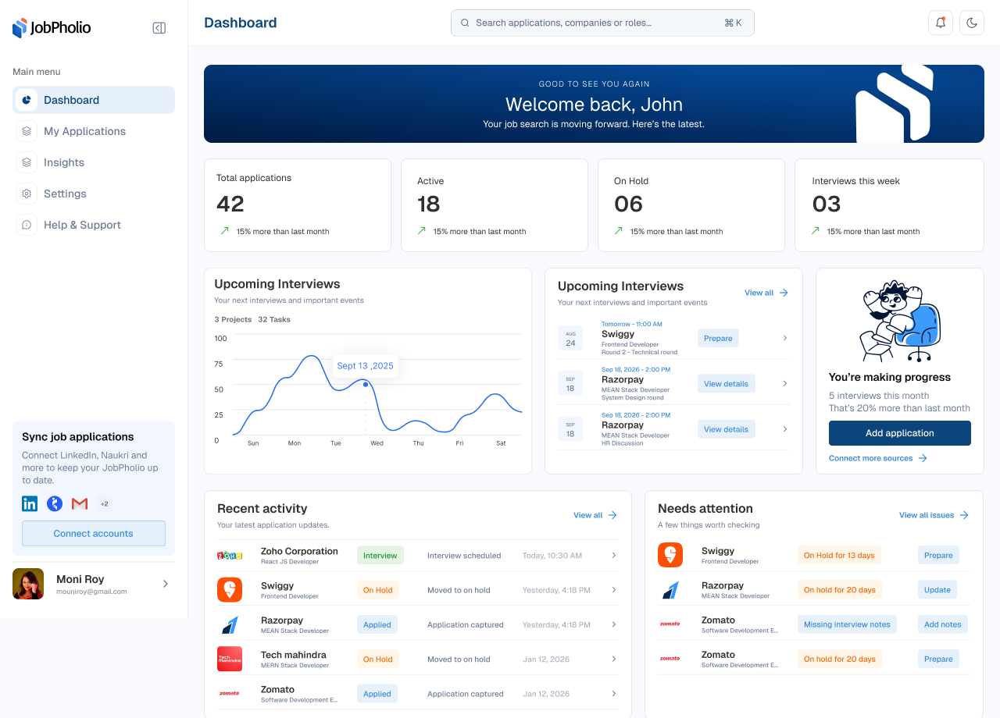

<div align="center">

# JobPholio

**Never lose track of a job application again.**

A job application tracker that keeps every application, wherever it was submitted, on one clean dashboard.




</div>

## Overview

Job seekers apply through LinkedIn, Naukri, company career pages, and referrals, and no single place records where they applied, when, or for which role. When a recruiter calls weeks later, it is easy to be caught off guard.

JobPholio solves this by giving you one place to log, organize, and review every application before that call. It is designed with first-class support for **Naukri.com** alongside global platforms, a gap that most existing trackers leave open for job seekers in India.

This repository contains the **web client**. It talks to a separate Node.js / Express / MongoDB REST API.

## Features

- **Dashboard**: an at-a-glance summary of total, active, and on-hold applications, upcoming interviews, application trends, recent activity, and items that need attention.
- **Application management**: add, view, edit, and delete applications with company, role, location, employment type, salary range (multi-currency), job link, and source.
- **Status tracking**: follow each application through *Applied → On Hold → Interview → Offer / Rejected*.
- **Filtering and sorting**: filter by status, source (LinkedIn, Naukri, company site), and time range, and sort by most recent or oldest.
- **Authentication**: sign up and log in, with protected routes and automatic access-token refresh.
- **Profile**: manage your profile details and upload an avatar with in-browser image cropping.
- **Light and dark themes**, plus a responsive layout for desktop and mobile.

## Tech Stack

| Area | Tools |
| --- | --- |
| Framework | Next.js 16 (App Router), React 19, TypeScript |
| Styling | Tailwind CSS 4, shadcn/ui, Base UI, Lucide icons |
| Data and tables | TanStack Table, dnd-kit |
| Charts | Recharts |
| Forms and validation | Zod, React Day Picker |
| UX | Sonner (toasts), Lottie animations, next-themes |

## Project Structure

```
app/
├── page.tsx                 # Landing page
├── (auth)/                  # Login and sign-up
└── (protected)/(dashboard)/ # Authenticated area
    ├── dashboard/
    ├── my-application/
    ├── profile/
    ├── insights/
    └── settings/
components/
├── applications/            # Add / view / list applications
├── dashboard/               # Dashboard cards and widgets
├── forms/                   # Auth forms
├── landing/                 # Landing page sections
└── ui/                      # Shared UI primitives
hooks/                       # Custom React hooks
lib/
├── constants/               # Status, source, and currency options
├── functions/               # API client and helpers
└── types/                   # Shared TypeScript types
```

## Getting Started

### Prerequisites

- Node.js 20+
- pnpm
- A running instance of the JobPholio backend API

### Setup

```bash
git clone https://github.com/Myself-Suyeesh/jobpholio-client.git
cd jobpholio-client
pnpm install
```

Create a `.env.local` file in the project root:

```env
NEXT_PUBLIC_API_URL=http://localhost:5000/api
```

Start the development server:

```bash
pnpm dev
```

Then open [http://localhost:3000](http://localhost:3000).

### Scripts

| Command | Description |
| --- | --- |
| `pnpm dev` | Start the development server |
| `pnpm build` | Create a production build |
| `pnpm start` | Run the production build |
| `pnpm lint` | Lint the codebase |

## Roadmap

- [x] Authentication and protected routes
- [x] Application CRUD with status tracking
- [x] Dashboard with metrics and activity
- [x] Profile management with avatar upload
- [ ] Insights page with detailed analytics
- [ ] Automatic "On Hold" status after a configurable no-response period
- [ ] AI-powered resume-to-job-description matching and JD parsing
- [ ] Chrome extension and email parsing to capture applications from LinkedIn, Naukri, and more

## License

This project is currently not licensed for reuse. All rights reserved.
